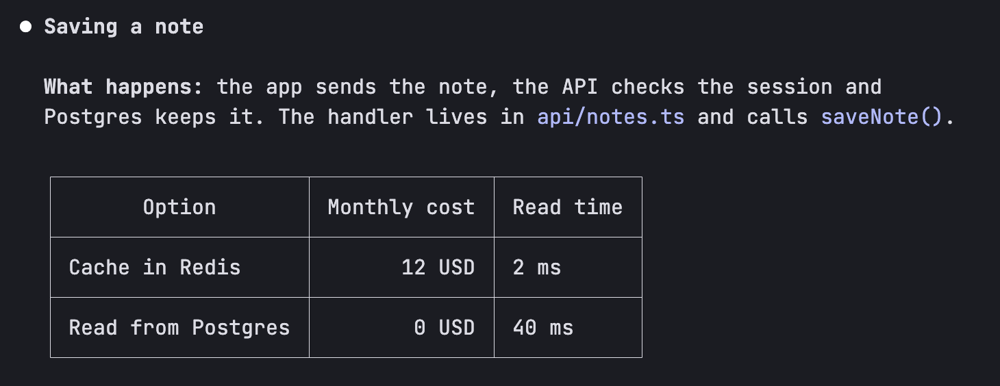
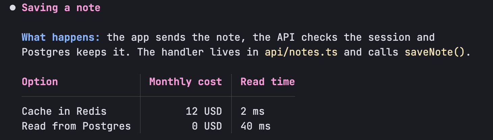
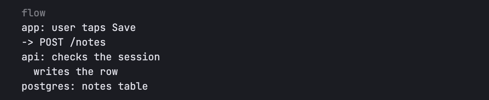
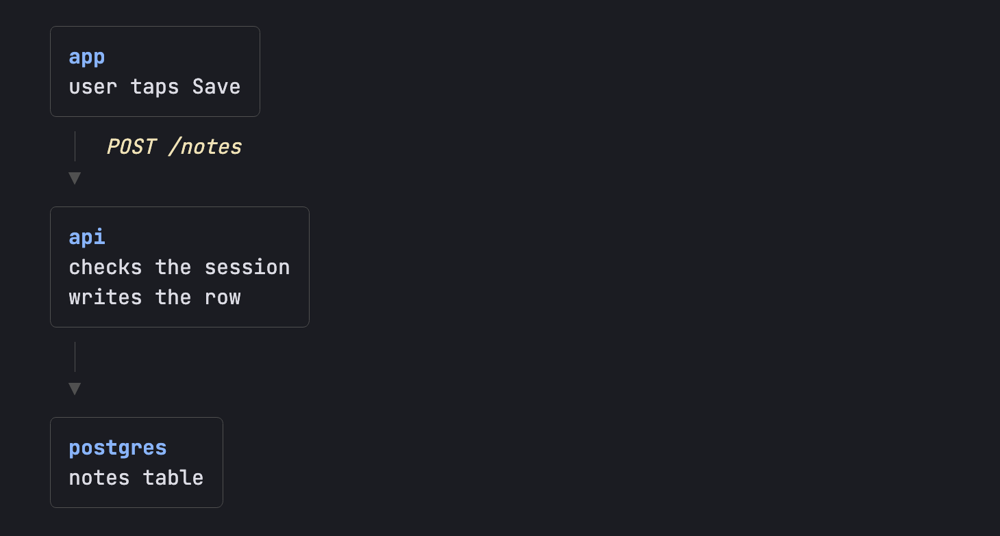
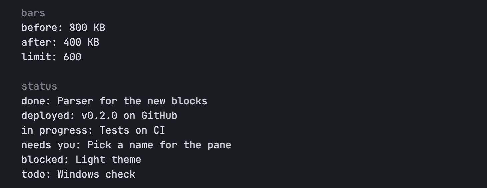
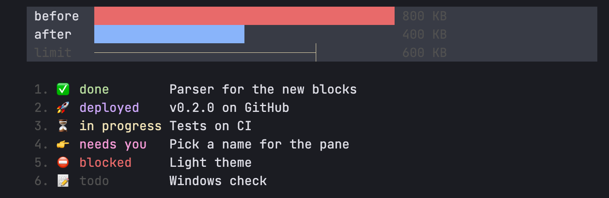
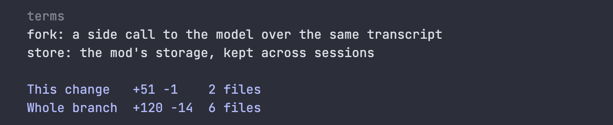
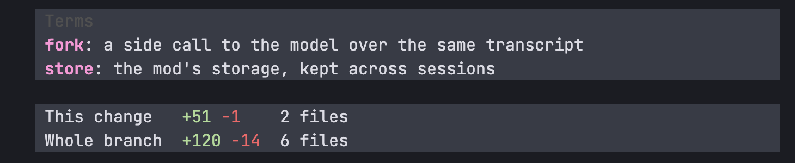
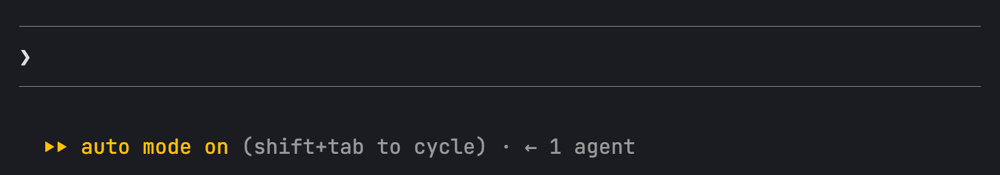
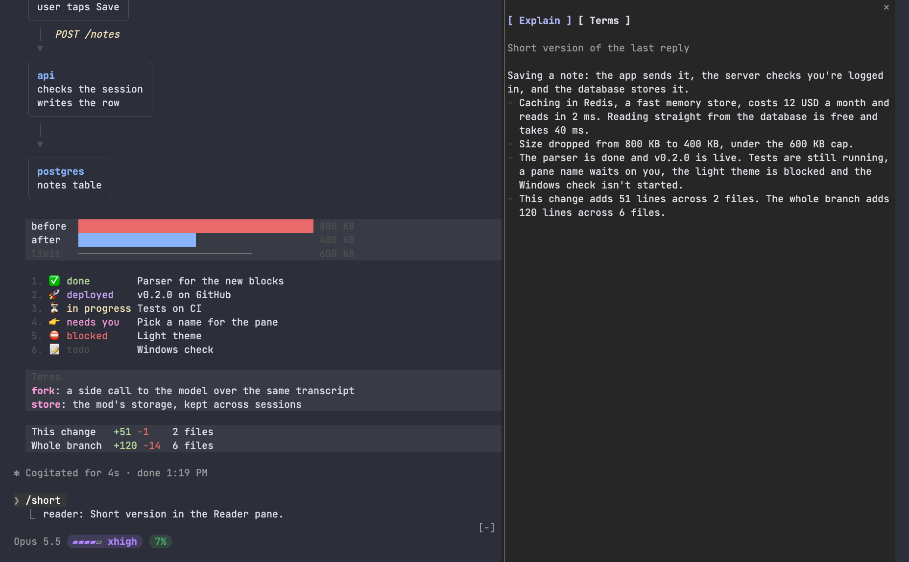

# claude-mods

Mods for Claude Code. One so far: **reader**. It redraws Claude's replies in the terminal so they read faster: colors, aligned tables, flow diagrams, bar charts, status lists with icons, a glossary that lasts across sessions, and the model, effort and context used in a row above the prompt.

Made for dark terminal themes. Built on Claude Code 2.1.329.

## Install

### Step by step for an agent

Paste this section to a Claude Code agent, or run it yourself.

1. Run `claude --version`. If it is older than 2.1.329, run `claude update` and check again.
2. Run `claude plugin list`. If it already shows `reader@oliver-mods`, skip to step 5.
3. Add the marketplace:
   ```sh
   claude plugin marketplace add olivercarvajal/claude-mods
   ```
4. Install the mod:
   ```sh
   claude plugin install reader@oliver-mods
   ```
5. Run `claude plugin list` again. It must show `reader@oliver-mods` with `Status: ✔ enabled`.
6. Tell the user to open a new chat, or to type `/reload-plugins` in each chat already open. An agent cannot run that command for them, and its own chat keeps the old look until then.
7. Ask the user to check it in that chat. The model and the effort show in a row right above the prompt, and a prompt like "show 800 KB and 400 KB as bars" draws a gray card with blue bars.

### Update

```sh
claude plugin marketplace update oliver-mods
claude plugin update reader@oliver-mods
```

Then `/reload-plugins` in each open chat.

### Uninstall

```sh
claude plugin uninstall reader@oliver-mods
```

## What you get

Every image below comes from a real Claude Code session, 78 columns wide. Claude got the same prompt twice, once with the mod off and once with it on.

### Colors and tables

| Element | Color |
| --- | --- |
| Headings, and lines that are only bold | pink `#f49ad6` |
| Bold text | blue `#89b4fa` |
| Inline code | cream `#f0e2b6` |
| Claude's pick (`Mía:` or `Mi recomendación:`) | green `#b5d99c` |
| Code blocks | on a `#383b45` card, language name on top |
| List markers, table lines, arrows | the theme's subtle gray |

Pipe tables line up in columns, headers in pink, numbers aligned the way the table says. A table wider than the terminal falls back to Claude Code's own.

**Without reader**



**With reader**



### Four new blocks

The mod adds a short section to Claude's system prompt that teaches it four fenced blocks and when to use each:

- `flow` for anything that moves across two or more systems or steps.
- `bars` for three or more numbers to compare. A `limit:` line draws the cap and turns the bars past it red.
- `status` for PRs, tasks or releases in order. "in progress" moves on its own, "needs you" waits on you.
- `terms` for names a reply leans on that you have not seen yet. Each one is saved to a glossary (up to 300, newest first) that `/terms` shows.

Without the mod, Claude Code prints those blocks as plain text.

#### flow

**Without reader**



**With reader**



#### bars and status

**Without reader**



**With reader**



#### terms and diff sizes

An unlabeled fence with counts like `+51 -1` draws the `+` numbers green and the `-` numbers red.

**Without reader**



**With reader**



An unlabeled fence drawn with box-drawing characters or arrows also gets gray lines, blue node names and cream labels.

### Model, effort and context above the prompt

A row right above the prompt, with a blank row over it so it does not touch the reply:

- The model, in gray.
- The effort of the last request in a round pill, in the colors of the `/effort` picker: five steps from `low` to `max`. While Claude works, `xhigh` shimmers and `max` cycles a rainbow, as in the picker.
- The context used in a round pill: green under 30%, yellow from 30%, red from 60%. Answers get worse well before the window fills, so yellow means think about `/compact` or `/clear` and red means do it. It shows from the first request on, and clears after `/compact` or `/clear` until the next one.

Until the first request the effort is the one `/effort` saved in your settings. After `/model` or `/effort` the row updates with the next request. The round ends are the Nerd Font half circles `U+E0B6` and `U+E0B4`: xterm.js terminals draw them on their own, other terminals need a Nerd Font. The pill tints are mixed for a `#2c2e39` background.

**Without reader**



**With reader**

![A row above the prompt: "Opus 5.5" in gray, a round purple pill with four of five steps and "xhigh", a round green "7%", and the engine's [-] mark above the row](docs/reader-footer-after.png)

### Commands

| Command | What it does |
| --- | --- |
| `/explain [question]` | Explains the question, or the text you selected in the chat, in a Reader pane next to the chat |
| `/catchup` | Recaps the session from the start: goal, what is decided, open items numbered, a status block, what comes next |
| `/terms` | Opens the glossary in the Reader pane |
| `/short` | Says the last reply again in a few lines, in the Reader pane |
| `/zero` | Explains the last reply from zero, with an example, in the Reader pane |

The pane answers come from a fork of the model over the same transcript. The main chat never sees them.



## Notes

- `Mía:` and `Mi recomendación:` are Spanish because my replies read that way. Change `INLINE_MARK` and `PICK` in `reader/hooks/blocks.ts` for your language.
- The colors are constants at the top of `reader/hooks/draw.tsx`.
- Only one mod should redraw Claude's replies (`AssistantMessage`). If you already run one that does, keep one of the two.
- Tests: `claude plugin test ./reader`
